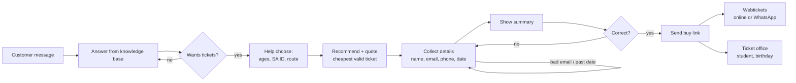

# Summit – Table Mountain Cableway ticket assistant

An AI agent that helps visitors choose the right Table Mountain Aerial Cableway tickets for their group, works out the total, collects their details and sends them to the official checkout.

**Live agent:** https://tvheehkf2kw7.run.agentplace.io

Built on [Agentplace](https://agentplace.io) with the free **Luna** model.

> Independent demo built from the Cableway's public website. Not affiliated with or endorsed by the Table Mountain Aerial Cableway Company. Tickets are only sold through official channels.

---

## The problem

"How much is a ticket?" has no single answer. The Cableway has 10+ ticket types, each with its own price and rules about who qualifies and where you can buy it:

- Online vs ticket office (online is cheaper)
- Return vs one way (e.g. hike up, ride down)
- Adult, child (4–17), under 4 (free)
- SA Senior (60+, SA ID), Student (ticket office only)
- Local is Lekker (South Africans, online only, not same-day)
- Birthday Special (free in your birthday month, ticket office only)
- Fast Track and the Virtual Cable Card

Summit asks a few questions, then picks the cheapest valid ticket for each person and shows the maths.

## Conversation flow

Example quote: *2 adults × R475 + 1 child × R230 + 1 under-4 free = **R1,180** (online, return).*

## Guardrails

- Prices, rules and policies come **only** from the knowledge base (official 2026/27 rates). No invented prices.
- Never guesses the weather or whether the Cableway is open. Points to the live status and explains the 7-day validity and refund.
- Never asks for card numbers, ID numbers or passwords.
- Warns that tickets from third-party websites are not valid.
- Checks eligibility before quoting a special (SA ID, student card, birthday month).
- Refuses prompt injection and off-topic requests.
- Says it is an independent demo if asked.

## Repository

| Path | What it is |
| --- | --- |
| [`agent/builder-prompt.md`](agent/builder-prompt.md) | First prompt given to the Agentplace builder |
| [`agent/instructions.md`](agent/instructions.md) | The agent's full instructions (system prompt) |
| [`agent/knowledge-base.md`](agent/knowledge-base.md) | Knowledge base built from the official website |
| [`qa/test-results.md`](qa/test-results.md) | 16 QA test cases and results |

## Testing

I tested the agent like QA before publishing: 16 cases covering the happy path, price maths, eligibility rules, a same-day special that isn't allowed, weather questions, invalid input, fake third-party tickets, prompt injection, card details and a question in Afrikaans.

One test failed on the first run: when asked "Is it open today?", the agent pointed to the live status but didn't mention that tickets are valid for 7 days and refundable if weather closes the mountain. I tightened that rule, retested, and it passed.

**Result: 16/16 passing.** See [`qa/test-results.md`](qa/test-results.md).

**Lesson:** with a small model, clear numbered rules, an exact price table and good test cases matter more than clever prompting.

## How it was built

1. Picked a real Cape Town business with many services, public prices and a clear payment step.
2. Mapped the conversation flow (above).
3. Wrote the instructions and the knowledge base from the official website.
4. Built the agent in the Agentplace builder on the Luna model.
5. Ran the 16 QA cases, fixed the one failure, and published.

## Sources

- [Ticket prices](https://www.tablemountain.net/plan-your-visit/ticket-prices)
- [Specials](https://tablemountain.net/plan-your-visit/specials)
- [Fast Track](https://www.tablemountain.net/plan-your-visit/fast-track)
- [Getting here](https://www.tablemountain.net/plan-your-visit/getting-here)
- [Wheelchair access](https://www.tablemountain.net/plan-your-visit/wheelchair-access-and-mobility-scooters)

Prices valid 1 July 2026 – 30 June 2027. The Local is Lekker special ends 30 November 2026.
